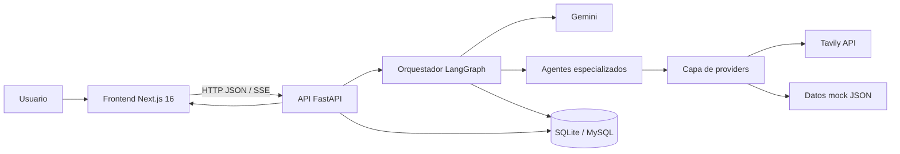
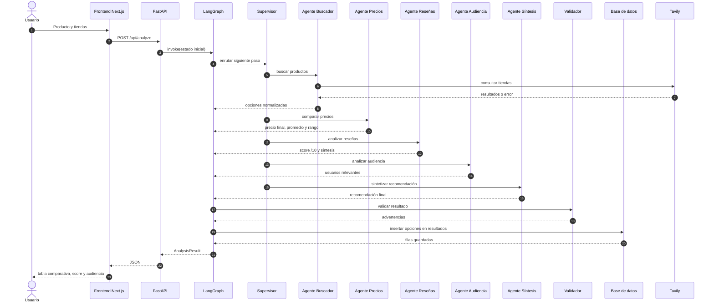
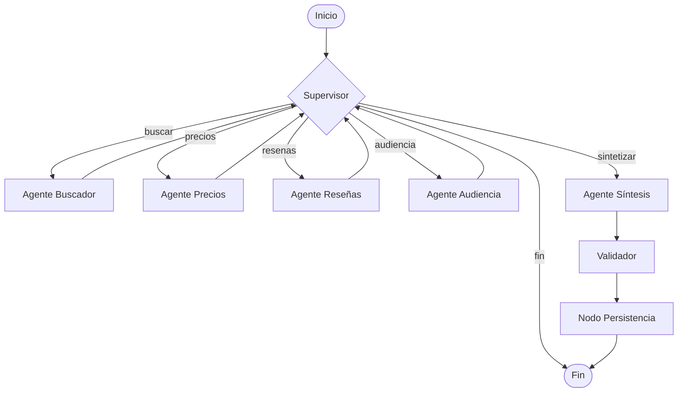
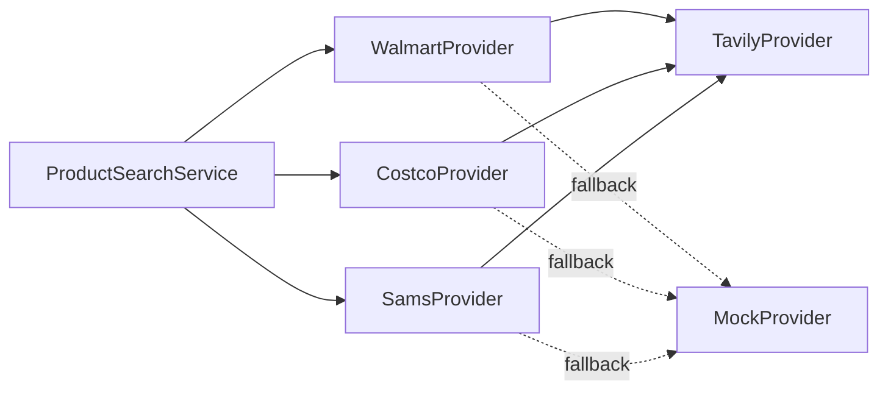

# Arquitectura del sistema

## 1. Propósito

Sistema multiagente que ayuda a decidir qué producto comprar consultando precios y reseñas en **Walmart**, **Costco** y **Sam's**, y registrando cada consulta en una base de datos.

El sistema debe:

1. Buscar productos en las tiendas seleccionadas.
2. Comparar precios y calcular precio final, promedio y rango.
3. Analizar al menos 3 reseñas y asignar un score sobre 10.
4. Identificar usuarios o personalidades relevantes que adquirieron el producto.
5. Insertar los resultados en la tabla `resultados` de la base de datos `analisis_compras`.

## 2. Alcance

**Incluido**

- Búsqueda de productos por tienda.
- Normalización de opciones (nombre, comercio, precio, URL, reseñas).
- Comparación de precios y análisis de reseñas.
- Análisis de audiencia.
- Persistencia en SQLite (desarrollo) o MySQL (entrega).
- Interfaz web y API HTTP.

**Fuera de alcance**

- Compra o pago real.
- Autenticación de usuarios finales.
- Scraping masivo o crawlers distribuidos.
- Entrenamiento de modelos propios.

## 3. Visión general (contenedores)



**Responsabilidades por contenedor**

| Contenedor | Tecnología | Responsabilidad |
|---|---|---|
| Frontend | Next.js 16, TypeScript, Tailwind CSS | Captura el producto, muestra comparación, score e historial. |
| API | FastAPI, Pydantic | Expone endpoints, valida entrada/salida y orquesta la ejecución del grafo. |
| Orquestador | LangGraph `StateGraph` | Controla el flujo entre agentes, ciclos y persistencia. |
| Agentes | LangChain + Gemini | Buscar, comparar, analizar reseñas y analizar audiencia. |
| Providers | Python + Tavily SDK | Obtener datos reales con respaldo mock. |
| Persistencia | SQLAlchemy + SQLite/MySQL | Guardar y consultar la tabla `resultados`. |
| LLM | Google Gemini | Razonamiento y generación de síntesis. |

## 4. Flujo de una consulta



El frontend usa `POST /api/analyze` para obtener el resultado completo o `POST /api/analyze/stream` para mostrar el avance por SSE.

## 5. Grafo multiagente

El grafo usa un **supervisor** que decide qué especialista actúa y vuelve a él tras cada paso. La síntesis usa Gemini, el validador cierra el análisis y el nodo de persistencia guarda las opciones en `resultados`.



**Reglas del supervisor**

- El flujo ejecuta los pasos en orden: búsqueda → precios → reseñas → audiencia → síntesis → validación; después se ejecuta la persistencia.
- Omite un paso si su resultado ya existe en el estado.
- Si la búsqueda falla o no devuelve opciones, registra el error y termina.
- Si un paso de análisis falla, usa el fallback heurístico y continúa.
- El validador agrega advertencias por tiendas faltantes, reseñas insuficientes o datos mock.
- La persistencia es *best-effort*: si la base de datos falla, el resultado se devuelve con una advertencia y un error registrado.

## 6. Estado compartido

El estado es un `TypedDict` (`AgentState`) en `backend/app/agents/state.py`. Los nodos devuelven actualizaciones parciales; las listas se reemplazan con el valor completo.

| Campo | Tipo | Descripción |
|---|---|---|
| `consulta` | `str` | Producto solicitado por el usuario. |
| `limite_por_tienda` | `int` | Opciones solicitadas por tienda. |
| `perfil` | `str \| None` | Perfil declarado por el usuario (opcional). |
| `tiendas` | `list[Store]` | Tiendas seleccionadas (`walmart`, `costco`, `sams`). |
| `opciones` | `list[ProductOption]` | Opciones normalizadas por tienda. |
| `tiendas_con_mock` | `list[Store]` | Tiendas que usaron el catálogo de respaldo. |
| `resumen_precios` | `PriceSummary \| None` | Precio final, promedio, mínimo, máximo y rango. |
| `resumen_resenas` | `ReviewSummary \| None` | Score /10, pros, contras y síntesis. |
| `resumen_audiencia` | `AudienceSummary \| None` | Perfiles o personalidades que compraron el producto. |
| `resultado` | `AnalysisResult \| None` | Respuesta final con recomendación y advertencias. |
| `filas_guardadas` | `int` | Filas insertadas en `resultados`. |
| `errores` | `list[str]` | Errores acumulados por paso. |
| `advertencias` | `list[str]` | Advertencias del validador. |
| `siguiente` | `str` | Decisión del supervisor para la siguiente arista. |
| `pasos` | `list[str]` | Traza de nodos ejecutados. |

## 7. Capa de datos (providers)



- `StoreProvider` define `search(query) -> list[ProductOption]`.
- `TavilyProvider` consulta la API real por tienda.
- `MockProvider` devuelve datos de `backend/data/mock/*.json`.
- El servicio normaliza nombres, precios y URLs, y deduplica resultados.
- Si la fuente real falla o no hay API key, se usa el mock para no romper la demo.

**Archivos**

| Archivo | Responsabilidad |
|---|---|
| `providers/base.py` | Interfaz `StoreProvider`. |
| `providers/tavily_provider.py` | Búsqueda real, filtrado de páginas de producto y extracción de precio/reseñas. |
| `providers/mock_provider.py` | Catálogo local y generación de opciones sintéticas para consultas desconocidas. |
| `providers/service.py` | Orquestación, fallback, deduplicación y orden por precio. |
| `providers/factory.py` | Construye el servicio según la presencia de `TAVILY_API_KEY`. |
| `models.py` | Modelos Pydantic compartidos (`ProductOption`, `SearchResult`, etc.). |

**Comportamiento implementado**

1. `TavilyProvider` consulta Tavily con `search_depth="advanced"` y se queda solo con URLs de producto (`/ip/` en Walmart y Sam's, `/p/` en Costco).
2. Descarta títulos genéricos (categorías, promociones) y accesorios que no corresponden al producto buscado.
3. Extrae precio y calificación con expresiones regulares y convierte fragmentos de contenido en reseñas.
4. `MockProvider` busca coincidencias por nombre, descripción y etiquetas; si no hay coincidencias, genera opciones sintéticas marcadas como `fuente="mock"`.
5. `ProductSearchService` usa mock cuando el provider falla o devuelve cero resultados, y completa hasta el límite solicitado sin duplicar nombres.
6. El resultado final se deduplica y se ordena por precio ascendente.

## 8. API HTTP

| Método | Ruta | Descripción | Fase |
|---|---|---|---|
| `POST` | `/api/analyze` | Ejecuta el grafo y devuelve el análisis completo. | 6 |
| `POST` | `/api/analyze/stream` | Igual que el anterior, con progreso vía SSE. | 6 |
| `GET` | `/api/history` | Últimas consultas registradas en `resultados`. | 6 |
| `GET` | `/api/stats` | Totales, mínimo, máximo, promedio y desglose por comercio. | 6 |
| `GET` | `/api/health` | Estado del servicio. | 1 |

La implementación está en `backend/app/api/` y el detalle en [`04_api.md`](04_api.md).

## 9. Persistencia

La tabla `resultados` guarda una fila por opción de producto analizada. El detalle del esquema está en [`03_base_de_datos.md`](03_base_de_datos.md).

- **Desarrollo:** SQLite en `backend/data/analisis_compras.db`.
- **Entrega:** MySQL 8.0, base `analisis_compras`.
- El motor se selecciona con `DATABASE_URL`.

## 10. Frontend

Next.js 16 (App Router) con React 19, TypeScript y Tailwind CSS 4. Las páginas son Client Components y consumen la API desde el navegador; el build no requiere que FastAPI esté levantado.

| Ruta | Descripción |
|---|---|
| `/` | Buscador, selección de tiendas, progreso del agente y resultados del análisis. |
| `/history` | Historial de consultas leídas desde la base de datos, con filtro y estadísticas. |

| Componente | Responsabilidad |
|---|---|
| `SearchBar` | Formulario de producto, tiendas, límite, perfil y opciones de ejecución. |
| `StoreSelector` | Selección de Walmart, Costco y Sam's. |
| `AgentProgress` | Nodos del grafo y traza de pasos en tiempo real. |
| `AnalysisView` | Recomendación, precios, comparación, reseñas y audiencia. |
| `PriceSummaryCards` | Precio mínimo, máximo, promedio y ahorro. |
| `ComparisonTable` | Tabla de opciones con tienda, precio, score, fuente y enlace. |
| `ReviewScoreGauge` | Score /10, pros, contras y fuentes. |
| `AudienceList` | Perfiles de comprador con porcentaje y evidencia. |
| `HistoryTable` | Filas persistidas con estados de carga y vacío. |
| `StatsCards` | Totales, rango de precios y promedio por comercio. |

El cliente `frontend/src/lib/api.ts` expone `analyze`, `analyzeStream`, `fetchHistory` y `fetchStats`; `NEXT_PUBLIC_API_URL` define la URL base. El detalle está en [`05_frontend.md`](05_frontend.md).

## 11. Requisitos no funcionales

| Requisito | Estrategia |
|---|---|
| Tolerancia a fallos | Fallback a mock, reintentos y registro de errores en el estado. |
| Rendimiento | Timeouts por agente y ejecución secuencial controlada por el supervisor. |
| Seguridad | Claves en `.env` (ignorado por git), CORS restringido y validación con Pydantic. |
| Observabilidad | Logs estructurados y traza de pasos en `historial`. |
| Portabilidad | SQLite/MySQL conmutables y ejecución local en Windows o Linux. |
| Mantenibilidad | Separación por capas (`graph`, `agents`, `tools`, `providers`, `db`). |
| Calidad | 64 pruebas backend con 90.8% de cobertura, 11 pruebas frontend, ESLint y build de Next.js. |

## 12. Estructura del repositorio

```text
analisis-compras/
├─ backend/
│  ├─ app/
│  │  ├─ main.py            # FastAPI
│  │  ├─ config.py          # settings y .env
│  │  ├─ api/               # esquemas y rutas FastAPI
│  │  ├─ graph/             # estado, nodos y aristas
│  │  ├─ agents/            # buscador, precios, reseñas, audiencia
│  │  ├─ tools/             # herramientas invocables
│  │  ├─ providers/         # Tavily y mock
│  │  ├─ db/                # modelos, sesión, init.sql
│  │  └─ prompts/           # plantillas de los agentes
│  ├─ data/mock/            # datos de respaldo
│  ├─ tests/
│  └─ requirements.txt
├─ frontend/
│  ├─ src/app/              # páginas / y /history
│  ├─ src/components/       # componentes de UI
│  └─ src/lib/              # cliente API, tipos y utilidades
├─ docs/                    # documentación
├─ scripts/                 # utilidades
├─ .env.example
└─ README.md
```

## 13. Decisiones de diseño

Las decisiones y sus alternativas están documentadas como ADRs en [`08_decisiones_tecnicas.md`](08_decisiones_tecnicas.md).

## 14. Riesgos y mitigaciones

| Riesgo | Impacto | Mitigación |
|---|---|---|
| Bloqueo o límites de Tavily | Sin datos reales | Fallback a mock y reintentos. |
| Límites del free tier de Gemini | Análisis incompleto | Timeouts, reintentos y ruta determinista de respaldo. |
| Datos inconsistentes entre tiendas | Comparación incorrecta | Normalizador único y pruebas por provider. |
| SQLite no cumple el requisito literal | Observación en la entrega | `DATABASE_URL` conmutable a MySQL y `init.sql`. |
| Fuga de API keys | Riesgo de seguridad | `.env` ignorado por git; solo `.env.example` se versiona. |

## 15. Roadmap

El plan por fases vive en el README principal. Estado actual: Fase 8 completada (pruebas y QA).
