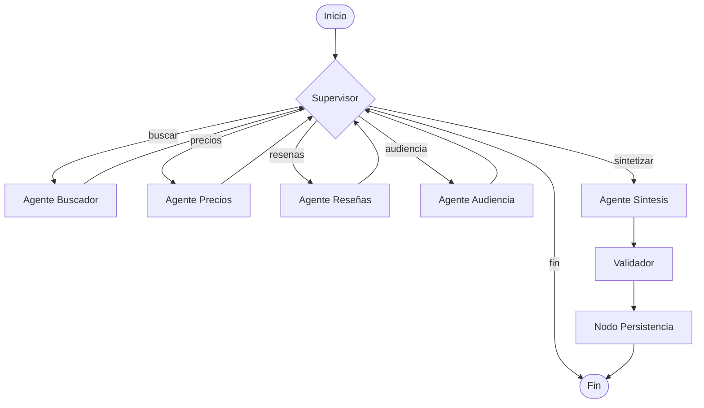

# Agentes y LangGraph

> Estado: completado en las Fases 4-5. Implementación en `backend/app/agents/`, `backend/app/graph/`, `backend/app/prompts/` y `backend/app/db/`.

## 1. Objetivo

Coordinar especialistas que buscan productos, comparan precios, analizan reseñas, identifican perfiles de usuario y sintetizan una recomendación. El grafo es explícito, inspeccionable y tolerante a fallos: si Tavily o Gemini fallan, el flujo continúa con datos mock y heurísticas.

## 2. Grafo implementado



| Archivo | Rol |
|---|---|
| `backend/app/agents/state.py` | `AgentState` y estado inicial. |
| `backend/app/agents/supervisor.py` | Enrutamiento y reglas de terminación. |
| `backend/app/agents/search_agent.py` | Búsqueda en tiendas. |
| `backend/app/agents/price_agent.py` | Estadísticas de precio. |
| `backend/app/agents/review_agent.py` | Análisis de reseñas. |
| `backend/app/agents/audience_agent.py` | Perfiles de usuario. |
| `backend/app/agents/synthesis_agent.py` | Recomendación final. |
| `backend/app/agents/validator.py` | Control de calidad y advertencias. |
| `backend/app/agents/persistence_agent.py` | Guardado en `resultados`. |
| `backend/app/graph/builder.py` | Construcción y ejecución del grafo. |
| `backend/app/prompts/__init__.py` | Plantillas de reseñas, audiencia y síntesis. |
| `backend/app/llm.py` | Cliente Gemini y utilidades de invocación/JSON. |
| `backend/app/db/models.py` | Modelo ORM `Resultado`. |
| `backend/app/db/session.py` | Motor, sesión e `init_db()`. |
| `backend/app/db/repository.py` | `ResultadoRepository`. |

## 3. Estado compartido

`AgentState` es un `TypedDict` con `total=False`. Cada nodo devuelve solo las claves que modifica; las listas se reemplazan con el valor completo.

| Campo | Tipo | Descripción |
|---|---|---|
| `consulta` | `str` | Producto solicitado. |
| `limite_por_tienda` | `int` | Opciones solicitadas por tienda. |
| `perfil` | `str \| None` | Perfil declarado por el usuario. |
| `tiendas` | `list[Store]` | Tiendas seleccionadas. |
| `opciones` | `list[ProductOption]` | Opciones normalizadas. |
| `errores` | `list[str]` | Errores acumulados. |
| `tiendas_con_mock` | `list[Store]` | Tiendas con datos de respaldo. |
| `resumen_precios` | `PriceSummary \| None` | Estadísticas de precio. |
| `resumen_resenas` | `ReviewSummary \| None` | Score, pros, contras y síntesis. |
| `resumen_audiencia` | `AudienceSummary \| None` | Perfiles relevantes. |
| `resultado` | `AnalysisResult \| None` | Respuesta final. |
| `filas_guardadas` | `int` | Filas insertadas en `resultados`. |
| `siguiente` | `Route` | Próximo nodo decidido por el supervisor. |
| `pasos` | `list[str]` | Traza de nodos ejecutados. |
| `advertencias` | `list[str]` | Advertencias del validador. |

## 4. Agentes

| Agente | Entrada principal | Salida | Usa LLM |
|---|---|---|---|
| Supervisor | `opciones` y resúmenes | `siguiente`, `pasos` | No |
| Buscador | `consulta`, `tiendas`, `limite_por_tienda` | `opciones`, `errores`, `tiendas_con_mock` | No |
| Precios | `opciones` | `PriceSummary` | No |
| Reseñas | `opciones` | `ReviewSummary` | Sí (JSON) + heurística |
| Audiencia | `opciones`, precios, reseñas | `AudienceSummary` | Sí (JSON) + heurística |
| Síntesis | Estado completo | `AnalysisResult` | Sí (texto) + fallback |
| Validador | `resultado` | `advertencias` | No |
| Persistencia | `resultado` | `filas_guardadas` | No |

### 4.1 Buscador

- Construye un `ProductQuery` y llama a `ProductSearchService`.
- Tavily consulta cada tienda con `search_depth="advanced"` y filtros de URL/título/accesorios.
- Si Tavily falla, no hay API key o no devuelve resultados, el servicio usa `MockProvider`.
- Completa hasta `limite_por_tienda` opciones por tienda sin duplicar nombres y ordena por precio.

### 4.2 Precios

- Ordena las opciones por precio y comercio.
- Calcula mínimo, máximo, promedio, rango, opciones consideradas y tienda más barata/cara.
- No usa LLM: es determinista y barato.

### 4.3 Reseñas

- Recopila reseñas de todas las opciones.
- Si hay menos de 3 textos, usa descripciones o nombres como respaldo y lo indica en la síntesis.
- Con Gemini: `REVIEW_PROMPT` pide un JSON con `score` (0-10), `sintesis`, `pros` y `contras`; `resenas_analizadas` y `fuentes` se recalculan en el código.
- Fallback heurístico: léxico positivo/negativo, frases compuestas y separación de cláusulas con `pero`, `aunque` y `sin embargo`.
- Filtra frases promocionales y listados de productos antes de elegir pros y contras.

### 4.4 Audiencia

- Perfiles base: Estudiante, Profesional, Gamer y Hogar.
- Heurísticas: precio, RAM/almacenamiento, palabras clave gamer y calificación.
- Con Gemini: `AUDIENCE_PROMPT` pide al menos 4 perfiles con descripción, evidencia y porcentaje de idoneidad; el código normaliza porcentajes (0-1 o 0-100) y completa con perfiles heurísticos si faltan.
- Si el usuario indica `--perfil`, se agrega al resumen si no existe.

### 4.5 Síntesis

- `SYNTHESIS_PROMPT` recibe opciones, precios, reseñas, perfiles y advertencias.
- Gemini redacta una recomendación de máximo 250 palabras en español.
- Fallback determinista: elige la opción más barata, resume precios, reseñas y perfiles, y advierte si hay datos mock.
- Construye el `AnalysisResult` final.

### 4.6 Validador

- Verifica que se analizaron las 3 tiendas.
- Verifica que `resenas_analizadas >= 3`.
- Advierte si hay opciones con `fuente="mock"` o errores parciales.
- Deduplica advertencias y las escribe en `resultado.advertencias`. No bloquea la entrega.

### 4.7 Persistencia

- Inserta una fila por cada `ProductOption` en `analisis_compras.resultados`.
- Usa `ResultadoRepository.save_result()` y guarda producto, comercio, precio y fecha.
- Actualiza `AnalysisResult.filas_guardadas` y `AgentState["filas_guardadas"]`.
- Es *best-effort*: si la base de datos falla, agrega una advertencia y un error, pero devuelve el resultado.
- `persist=False` en `run_analysis()` o `--sin-db` en el CLI omiten el guardado.

## 5. Reglas del supervisor

El supervisor (`backend/app/agents/supervisor.py`) es determinista:

1. Si no hay `opciones`:
   - termina si ya se ejecutó el buscador o hay errores;
   - en caso contrario, decide `buscar`.
2. Si faltan precios, decide `precios`.
3. Si faltan reseñas, decide `resenas`.
4. Si falta audiencia, decide `audiencia`.
5. Si falta `resultado`, decide `sintetizar`.
6. En cualquier otro caso, decide `fin`.

Tras `sintetizar` se ejecuta siempre el validador, luego el nodo de persistencia y finalmente termina el grafo. La persistencia se implementó en la Fase 5.

## 6. LLM y prompts

- Modelo: `gemini-3.8-flash`, configurable con `GEMINI_MODEL`.
- Cliente: `ChatGoogleGenerativeAI` con `temperature=0.2`, `max_output_tokens=2048` y `model_kwargs={"transport": "rest"}` para evitar bloqueos de gRPC en Windows.
- `invoke_text` captura excepciones y devuelve `None`; `invoke_json` limpia bloques Markdown y tolera texto alrededor del JSON.
- Prompts en `backend/app/prompts/__init__.py`: `REVIEW_PROMPT`, `AUDIENCE_PROMPT` y `SYNTHESIS_PROMPT`.
- Cuota gratuita: 20 solicitudes/día para `gemini-3.8-flash`. Al agotarse, el agente sigue funcionando con los fallbacks.
- `scripts/run_agent.py --sin-llm` fuerza el modo heurístico, útil para demos y pruebas sin cuota.

## 7. Manejo de errores

| Fallo | Comportamiento |
|---|---|
| Tavily lanza excepción | Se usa el catálogo mock de la tienda. |
| Tavily devuelve pocos resultados | Se completa con mock hasta el límite. |
| Gemini falla, agota cuota o devuelve JSON inválido | Se usa la heurística o el texto determinista. |
| La búsqueda no devuelve opciones | El supervisor termina y reporta `errores`. |
| Faltan tiendas o reseñas | El validador agrega advertencias. |
| La base de datos falla | El nodo de persistencia agrega una advertencia y un error; el resultado se devuelve igual. |

## 8. Ejecución y pruebas

```bash
# Agente con Gemini + Tavily
.venv/Scripts/python.exe scripts/run_agent.py "laptop" --limite 3

# Modo heurístico (sin Gemini)
.venv/Scripts/python.exe scripts/run_agent.py "laptop" --limite 3 --sin-llm

# Salida JSON (el mensaje de modo se escribe en stderr)
.venv/Scripts/python.exe scripts/run_agent.py "laptop" --limite 3 --json

# Omitir la persistencia
.venv/Scripts/python.exe scripts/run_agent.py "laptop" --limite 3 --sin-db
```

```bash
# Historial persistido
.venv/Scripts/python.exe scripts/history.py --limite 20

# Datos de ejemplo (opcional: --limpiar)
.venv/Scripts/python.exe scripts/seed.py --limpiar

# Vaciar la tabla
.venv/Scripts/python.exe scripts/clear.py --yes
```

```bash
cd backend
../.venv/Scripts/python.exe -m pytest -q
```

Cobertura actual: **64 pruebas** en verde y 90.8% de cobertura de backend. Incluyen providers, agentes, configuración, LLM, factory, Tavily con cliente falso, construcción del grafo, ruteo, fallback con LLM falso, reseñas heurísticas, repositorio, persistencia con SQLite temporal y endpoints de la API (incluido SSE).

## 9. Limitaciones y siguientes pasos

- La persistencia en `analisis_compras.resultados` y su consulta por API están implementadas (`/api/history`, `/api/stats`).
- La API FastAPI se conecta al grafo en la Fase 6; ver [`04_api.md`](04_api.md).
- Los precios reales dependen de Tavily; conviene validarlos antes de comprar.
- La cuota gratuita de Gemini limita las ejecuciones con LLM por día; el modo `--sin-llm` es la alternativa estable.
