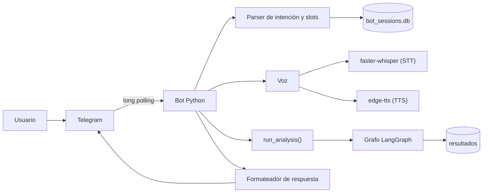

# Bot de Telegram

> Estado: implementación completa (texto, voz, sesiones y despliegue). Este documento describe el comportamiento y sirve de contrato operativo.

## 1. Objetivo

Ofrecer el asistente de compras desde el móvil y el escritorio mediante un bot privado de Telegram. El bot:

- entiende texto y notas de voz en español;
- pregunta los datos que falten antes de ejecutar;
- pide confirmación antes de lanzar el análisis;
- devuelve enlaces de los productos encontrados;
- entrega una reseña corta de los **tres mejores productos** (el recomendado y los dos siguientes);
- puede responder con audio corto por producto;
- funciona en un VPS Ubuntu 24/7 sin Docker, con `venv` y `systemd`.

La interfaz web sigue disponible, pero no es necesaria para usar el bot.

## 2. Decisiones de diseño

| Tema | Decisión |
|---|---|
| Plataforma | Telegram Bot API con *long polling*. Sin webhook, dominio ni puerto público. |
| Acceso | Privado: allowlist de IDs numéricos de Telegram. |
| Entrada | Texto y voz. La voz se transcribe localmente con `faster-whisper`. |
| Salida | Texto siempre; audio corto opcional con `edge-tts`. |
| Motor | Reutiliza el grafo LangGraph existente mediante `run_analysis()`. |
| Modo por defecto | `fast`: heurísticas, sin Gemini, para cuidar la cuota gratuita. |
| Modo opcional | `detallado`: usa Gemini para reseñas, audiencia y síntesis. |
| Persistencia | `resultados` sigue guardando el análisis; las conversaciones viven en un SQLite aparte. |
| Despliegue | Ubuntu + `venv` + `systemd`. Sin Docker. |
| Audio | Un audio breve por cada producto del top 3, con límite de duración. |

## 3. Arquitectura



El bot no pasa por FastAPI: importa el servicio del grafo y lo ejecuta en un hilo para no bloquear el *event loop* de `python-telegram-bot`.

### 3.1 Componentes

| Componente | Archivo | Responsabilidad |
|---|---|---|
| Entrada | `backend/app/bot/main.py` | Arranque, configuración y polling. |
| Handlers | `backend/app/bot/handlers.py` | Comandos, mensajes, botones y confirmación. |
| Conversación | `backend/app/bot/conversation.py` | Máquina de estados y slots. |
| Parser | `backend/app/bot/parser.py` | Extrae producto, tiendas, presupuesto, perfil y modo. |
| Formateador | `backend/app/bot/formatter.py` | Mensajes, top 3, enlaces y división por longitud. |
| Voz | `backend/app/bot/voice.py` | Descarga, transcripción y síntesis. |
| Sesiones | `backend/app/bot/session_store.py` | Persistencia de conversaciones en SQLite. |
| Ejecución | `backend/app/bot/runner.py` | Invoca `run_analysis()` fuera del event loop. |

## 4. Flujo de conversación

Estados principales:

```text
IDLE -> RECOLECTANDO -> CONFIRMANDO -> EJECUTANDO -> RESULTADOS
                         |                 |
                         +-> CANCELADO <---+ (error o /cancelar)
```

1. El usuario escribe o dicta una consulta, por ejemplo: *"Busca una laptop para la universidad, máximo 15 mil, en Walmart y Costco"*.
2. El parser extrae lo que pueda de forma determinista: producto, tiendas, presupuesto, perfil y modo.
3. Si falta el producto, el bot lo pregunta. Si no se indican tiendas, se asumen las tres; si no hay presupuesto o perfil, se ofrecen como opcionales.
4. El bot muestra un resumen con botones **Analizar**, **Cambiar datos** y **Cancelar**.
5. Al confirmar, se ejecuta el grafo con `usar_llm` según el modo activo.
6. El bot envía el resultado: recomendación, enlaces y reseñas del top 3.
7. Si el usuario pidió voz (o el modo de respuesta es `auto` y la entrada fue voz), envía un audio corto por cada producto del top 3.

### 4.1 Datos que se piden

| Dato | Obligatorio | Valor por defecto | Pregunta si falta |
|---|---|---|---|
| Producto | Sí | — | *"¿Qué producto quieres comparar?"* |
| Tiendas | No | Las tres | *"¿Restringimos a Walmart, Costco o Sam's?"* |
| Presupuesto | No | Sin límite | *"¿Tienes un presupuesto máximo en MXN?"* |
| Perfil | No | Sin perfil | *"¿Es para estudiante, profesional, gamer u hogar?"* |
| Modo | No | `fast` | Se cambia con `/modo`. |

El parser intenta primero reglas deterministas (números, monedas, nombres de tiendas y palabras clave). Solo si la consulta es ambigua se puede recurrir a un LLM para extraer slots; esa llamada es opcional y está desactivada por defecto para no gastar cuota.

## 5. Comandos y botones

| Comando | Acción |
|---|---|
| `/start` | Bienvenida, estado del bot y ejemplo de consulta. |
| `/nuevo` | Inicia una conversación nueva y borra los slots actuales. |
| `/cancelar` | Cancela la conversación o la ejecución en curso. |
| `/ayuda` | Comandos, modos y ejemplos. |
| `/modo` | Alterna entre `fast` y `detallado` con botones. |
| `/voz` | Configura la respuesta de audio: `auto`, `siempre` o `nunca`. |
| `/estado` | Muestra el modo, la voz y los datos recolectados. |

Los botones en línea se usan para tiendas, confirmación, cambio de modo y cancelación. Los botones incluyen `callback_data` corto y validado; no se confía en texto libre para acciones sensibles.

## 6. Modos de análisis

| Modo | Gemini | Uso | Comportamiento |
|---|---|---|---|
| `fast` | No | Predeterminado | Búsqueda con Tavily/mock, precios y reseñas heurísticas. |
| `detallado` | Sí | Bajo demanda | Reseñas, audiencia y síntesis con Gemini; fallback si falla. |

`fast` no significa "sin búsqueda real": sigue usando Tavily si hay clave. Solo omite las llamadas a Gemini. Si se agota la cuota o Gemini falla, el modo `detallado` cae a las heurísticas sin romper la conversación.

## 7. Voz

### 7.1 Entrada

- El bot acepta mensajes de voz y archivos de audio.
- Descarga el archivo a un directorio temporal, lo decodifica con PyAV a mono 16 kHz y lo transcribe con `faster-whisper`.
- Modelo por defecto: `small`, `device=cpu`, `compute_type=int8`, idioma `es`.
- Duración máxima de entrada: `BOT_MAX_AUDIO_SECONDS` (por defecto 120 s).
- El texto transcrito se muestra al usuario antes de continuar, para que pueda corregirlo.
- Los temporales se eliminan siempre, incluso si falla la transcripción.

### 7.2 Salida

- `edge-tts` genera el audio; la voz por defecto es `es-MX-JorgeNeural`.
- Telegram prefiere notas de voz en OGG/Opus. PyAV transcodifica el MP3 de `edge-tts` a OGG/Opus; si falla, se envía como archivo de audio MP3.
- Se envía **un audio breve por cada producto del top 3**, no un audio largo con todo el análisis.
- El audio se limita a unos 30-45 segundos por producto. El texto completo siempre acompaña al audio.
- Modos de respuesta: `auto` (audio solo si la entrada fue voz), `siempre` y `nunca`.
- Si `edge-tts` falla, se registra el error y se envía solo texto; nunca se bloquea la respuesta.

## 8. Resultado: enlaces y top 3

1. Se agrupan las opciones por producto normalizado para evitar repetir el mismo modelo en varias tiendas.
2. Se elige el producto recomendado por el agente y se completan dos productos más, priorizando precio y variedad.
3. Se muestran todos los enlaces encontrados, agrupados por producto o tienda.
4. Para cada producto del top 3 se incluye:
   - nombre y tienda(s);
   - precio y enlace directo;
   - score y reseña corta (pros/contras) calculados con `heuristic_review` sobre las reseñas disponibles;
   - una línea de "por qué está en el top".
5. Se respetan los límites de Telegram: los mensajes largos se dividen en bloques de menos de 4096 caracteres y los enlaces se envían como texto plano o botones de URL.

La reseña del top 3 no requiere llamadas adicionales a Gemini: se reutiliza el análisis heurístico existente. En modo `detallado`, la síntesis del agente puede enriquecer la recomendación principal.

## 9. Sesiones y datos

- Cada conversación se guarda en `backend/data/bot_sessions.db` (SQLite).
- La tabla de sesiones almacena: `chat_id`, `user_id`, `estado`, slots en JSON, `modo`, preferencia de voz, último resultado y marcas de tiempo.
- Las sesiones expiran por inactividad (`BOT_SESSION_TTL_HOURS`, por defecto 24 h).
- `resultados` no cambia: el bot guarda el análisis con el mismo repositorio y respeta `guardar=True`.
- El bot no guarda audios ni transcripciones después de responder. Solo conserva el texto de la consulta si el análisis se persiste en `resultados`.
- La sesión no sustituye la base de datos del proyecto; es estado efímero de conversación.

## 10. Seguridad y privacidad

- **Allowlist:** solo los IDs de `TELEGRAM_ALLOWED_USER_IDS` pueden usar el bot. Cualquier otro usuario recibe un rechazo genérico y se registra el intento sin datos sensibles.
- **Token:** `TELEGRAM_BOT_TOKEN` vive en `.env`, con permisos `600`, y nunca se escribe en logs. Si se filtra, se revoca en BotFather.
- **Privacidad:** Telegram no es cifrado de extremo a extremo para bots; los mensajes pasan por servidores de Telegram. No se deben enviar datos sensibles.
- **Rate limit:** límite por usuario (`BOT_RATE_LIMIT_PER_HOUR`, por defecto 10 análisis/hora) para evitar abuso y consumo de cuota.
- **Usuario del servicio:** el bot corre como usuario sin privilegios (`comprasbot`), no como `root`.
- **Red:** solo se necesita salida HTTPS. No se abren puertos para el bot; el VPS puede mantener solo SSH.
- **Temporales:** audios y archivos convertidos se borran tras cada respuesta.
- **Dependencias:** el bot base usa `requirements-bot.txt`; la voz opcional usa `requirements-voice.txt`.

## 11. Configuración

Variables nuevas en `.env` (ver también `.env.example`):

| Variable | Default | Descripción |
|---|---|---|
| `TELEGRAM_BOT_TOKEN` | — | Token de BotFather. Obligatorio. |
| `TELEGRAM_ALLOWED_USER_IDS` | — | IDs numéricos separados por coma. Obligatorio. |
| `BOT_DEFAULT_MODE` | `fast` | `fast` o `detallado`. |
| `BOT_SESSION_TTL_HOURS` | `24` | Expiración de sesiones. |
| `BOT_RATE_LIMIT_PER_HOUR` | `10` | Análisis permitidos por usuario. |
| `BOT_MAX_AUDIO_SECONDS` | `120` | Duración máxima del audio de entrada. |
| `BOT_VOICE_REPLY_MODE` | `auto` | `auto`, `siempre` o `nunca`. |
| `TELEGRAM_TTS_VOICE` | `es-MX-JorgeNeural` | Voz de `edge-tts`. |
| `TELEGRAM_STT_MODEL` | `small` | Modelo de `faster-whisper`. |
| `TELEGRAM_STT_DEVICE` | `cpu` | `cpu` o `cuda`. |
| `TELEGRAM_STT_COMPUTE_TYPE` | `int8` | Precisión de `faster-whisper`. |

Las claves existentes (`GEMINI_API_KEY`, `TAVILY_API_KEY`, `DATABASE_URL`) se reutilizan.

## 12. Ejecución local (Windows)

```bash
# Desde la raíz del proyecto
python -m venv .venv
.venv/Scripts/activate
pip install -r backend/requirements.txt
pip install -r backend/requirements-bot.txt
# Voz opcional:
# pip install -r backend/requirements-voice.txt

# Configura .env con TELEGRAM_BOT_TOKEN y TELEGRAM_ALLOWED_USER_IDS
.venv/Scripts/python.exe scripts/run_bot.py
```

Para probar sin Telegram se puede usar el runner del grafo y las pruebas unitarias del bot. La transcripción usa PyAV y no requiere `ffmpeg`; si faltan las dependencias de voz, la voz no está disponible y el bot sigue funcionando solo con texto.

## 13. Despliegue en Ubuntu sin Docker

### 13.1 Requisitos del VPS

- Ubuntu 24.04 LTS.
- 2 GB de RAM mínimo; 4 GB recomendados si se usa `faster-whisper` con `small`.
- 10 GB de disco libres.
- Salida HTTPS permitida.
- `python3.12`, `python3.12-venv` y `git`.
- PyAV se instala con `backend/requirements-voice.txt`; no se requiere `ffmpeg` del sistema.

### 13.2 Instalación

```bash
sudo apt update
sudo apt install -y python3.12 python3.12-venv python3-pip git
sudo adduser --system --group --home /opt/analisis-compras comprasbot
sudo mkdir -p /opt/analisis-compras
sudo chown -R comprasbot:comprasbot /opt/analisis-compras

sudo -u comprasbot git clone https://github.com/Laineess/Asistente-de-compras.git /opt/analisis-compras
cd /opt/analisis-compras
sudo -u comprasbot python3.12 -m venv .venv
sudo -u comprasbot .venv/bin/pip install --upgrade pip
sudo -u comprasbot .venv/bin/pip install -r backend/requirements.txt -r backend/requirements-bot.txt
# Voz opcional:
# sudo -u comprasbot .venv/bin/pip install -r backend/requirements-voice.txt
```

Crea `/opt/analisis-compras/.env` con las claves y permisos restringidos:

```bash
sudo -u comprasbot nano /opt/analisis-compras/.env
sudo chmod 600 /opt/analisis-compras/.env
```

### 13.3 Servicio `systemd`

Archivo versionado: `deploy/compras-bot.service` (se copia a `/etc/systemd/system/compras-bot.service`).

```ini
[Unit]
Description=Bot de Telegram - Analisis de Compras
After=network-online.target
Wants=network-online.target

[Service]
Type=simple
User=comprasbot
Group=comprasbot
WorkingDirectory=/opt/analisis-compras/backend
EnvironmentFile=/opt/analisis-compras/.env
Environment=PYTHONUNBUFFERED=1
Environment=HF_HOME=/opt/analisis-compras/.cache/huggingface
Environment=XDG_CACHE_HOME=/opt/analisis-compras/.cache
ExecStart=/opt/analisis-compras/.venv/bin/python -m app.bot.main
Restart=on-failure
RestartSec=5
TimeoutStopSec=30
NoNewPrivileges=true
PrivateTmp=true
ProtectSystem=full
ProtectHome=true
ReadWritePaths=/opt/analisis-compras/backend/data /opt/analisis-compras/.cache
UMask=0077

[Install]
WantedBy=multi-user.target
```

Activa el servicio:

```bash
sudo systemctl daemon-reload
sudo systemctl enable --now compras-bot
sudo systemctl status compras-bot
sudo journalctl -u compras-bot -f
```

No se abre ningún puerto para el bot. Solo se requiere salida HTTPS hacia Telegram, Gemini y Tavily. Se recomienda `ufw` con SSH permitido y el resto cerrado.

### 13.4 Actualización

```bash
cd /opt/analisis-compras
sudo -u comprasbot git pull
sudo -u comprasbot .venv/bin/pip install -r backend/requirements.txt -r backend/requirements-bot.txt
# Voz opcional:
# sudo -u comprasbot .venv/bin/pip install -r backend/requirements-voice.txt
sudo systemctl restart compras-bot
```

## 14. Operación

- Logs: `journalctl -u compras-bot -f`.
- Estado: `systemctl status compras-bot`.
- Reinicio: `systemctl restart compras-bot`.
- Sesiones: se pueden borrar con `rm backend/data/bot_sessions.db` con el servicio detenido.
- Respaldo: copiar `backend/data/analisis_compras.db` y `backend/data/bot_sessions.db` con el servicio detenido.
- El bot no requiere el frontend ni `uvicorn`; si se quiere la web, se despliega aparte.

## 15. Pruebas implementadas

| Archivo | Alcance |
|---|---|
| `backend/tests/bot/test_parser.py` | Producto, tiendas, presupuesto, perfil y modo. |
| `backend/tests/bot/test_conversation.py` | Slots, estados, confirmación y cancelación. |
| `backend/tests/bot/test_session_store.py` | Persistencia, expiración y aislamiento por usuario. |
| `backend/tests/bot/test_formatter.py` | Top 3, enlaces, división de mensajes y audio. |
| `backend/tests/bot/test_voice.py` | STT/TTS, PyAV, conversión, fallbacks y limpieza. |
| `backend/tests/bot/test_handlers.py` | Allowlist, comandos, rate limit, voz y flujo completo con grafo falso. |

Las pruebas no descargan modelos ni llaman a Telegram. El bot suma **76 pruebas** a las 67 existentes: **143 pruebas backend** en total, con 90.6% de cobertura.

## 16. Limitaciones

- Telegram no es un canal E2E; no usar para información sensible.
- La calidad de la transcripción depende del audio y del modelo local.
- `faster-whisper` consume CPU/RAM; el primer arranque descarga el modelo.
- Los precios dependen de Tavily/mock y deben validarse antes de comprar.
- El modo `detallado` consume la cuota gratuita de Gemini.
- No hay aplicación nativa ni web app de Telegram; se usa el chat.
- La interfaz web no está pensada para móvil como el bot, pero sigue funcionando.

## 17. Solución de problemas

| Síntoma | Causa probable | Acción |
|---|---|---|
| El bot no responde | Servicio caído, token inválido o sin red | `systemctl status`, `journalctl`, revisar `TELEGRAM_BOT_TOKEN`. |
| Responde "no autorizado" | ID fuera de la allowlist | Agregar el ID numérico a `TELEGRAM_ALLOWED_USER_IDS`. |
| No transcribe voz | Dependencias de voz, modelo o formato inválido | Instalar `backend/requirements-voice.txt`, revisar logs y duración máxima. |
| No envía audio | `edge-tts` sin red o voz inválida | Revisar logs; el bot debe seguir enviando texto. |
| Respuestas lentas | Modelo `small` en CPU o búsqueda real | Usar modo `fast`, reducir audio o ampliar el VPS. |
| Gemini falla o agota cuota | Límite del free tier | Cambiar a `fast` con `/modo`. |
| Datos mock | Tavily sin clave o con error | Configurar `TAVILY_API_KEY`; los mock son sintéticos. |
| Sesión atascada | Estado inconsistente | `/cancelar`, `/nuevo` o borrar `bot_sessions.db` con el servicio detenido. |

## 18. Referencias

- Arquitectura: [`01_arquitectura.md`](01_arquitectura.md).
- Grafo y agentes: [`02_agentes_y_langgraph.md`](02_agentes_y_langgraph.md).
- Base de datos: [`03_base_de_datos.md`](03_base_de_datos.md).
- Decisiones: [`08_decisiones_tecnicas.md`](08_decisiones_tecnicas.md).
